# GUI01 のアルゴリズムの変遷

この文書は、GUI01 の解析段階（背景補正、二値化、細線化、ファイバーの中心線、
キンク検出）を、版 1.0.0 から現在のコードまで追い、各変更が同梱のテストスキャンで
何をもたらしたかを示す。[`algorithms.ja.md`](algorithms.ja.md) は
現在のコードが何を計算するかを説明し、この文書はそれがどのような経緯でその計算に
至ったかを説明する。

## 図の作り方

図はすべて `scripts/make_history_figures.py` が描く。比べる版ごとに、その版の
`lib/` を固定したコミットで Git から取り出し、その版の既定値のまま別プロセスで
実行するので、各列はその版が実際に出した結果を示す。2 章以降は、示す段階への
入力として、現在のコードの前の段階の出力をどの版にも同じように与える。そのため、
図はその段階の変化だけを示す。スキャンは同梱の 3 つのテストスキャンで、画像全体を
示す。

| スキャン | ファイル |
|---|---|
| Tunicate CNF | `testdata_tunicateCNF/TunicateACTOCCNF.txt` |
| Higher-plant TOC-CNF | `testdata_higherplantTOC/_20250318-164122_T.ssp .txt` |
| NDTOC (Bruker) | `testdata_Bruker_txt/NDTOC250306.000.txt` |

比べる版は次のとおり。

| ラベル | コミット | 日付 |
|---|---|---|
| 1.0.0 | `3c28dec`（タグ `v1.0.0`） | 2026-07-08 |
| 2.0.0 | `f9c1ad8`（タグ `v2.0.0`） | 2026-09-17 |
| c43409b | `c43409b`（未リリース） | 2026-11-09 |

この文書の図は縮小版である。
`.venv\Scripts\python.exe scripts\make_history_figures.py --full` を実行すると、
スキャンの 1 画素を画面のほぼ 1 画素で描いた同じ図が `.tmp/history/full/` に書き出される。
`--check` は、以下で変化を 1 つのコミットに帰したり、その由来を説明したりする記述の
裏付けとなる測定値を表示する。

## 1. 背景補正

各図は 2 段からなる。A 段は生のスキャン（色の範囲はそれ自身のもの）と各版の補正後の
画像で、補正後の 3 枚は、`lib.ui_tools.compute_auto_vrange` が c43409b の結果から
求める自動表示範囲にそろえてある。B 段は同じ補正後の画像を −1〜+1 nm で示す。
背景の残りが見えるようになり、ファイバーは白く飽和する。

### 1.1 既定の方式: `inpaint` から `trendfill` へ（2.0.0）

[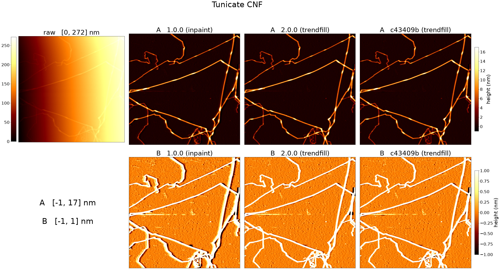](images/history/background_default_tunicate.jpg)

[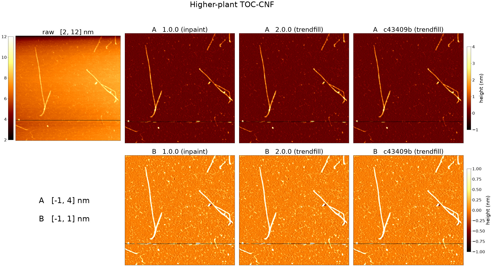](images/history/background_default_higherplant.jpg)

[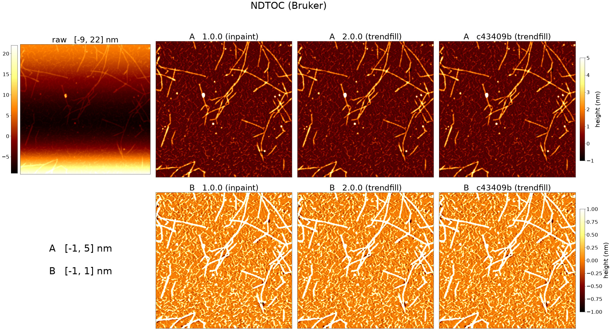](images/history/background_default_ndtoc.jpg)

1.0.0 の既定の方式は `inpaint` だった。ファイバーをマスクし、マスクした画素を
OpenCV の Navier-Stokes インペインティング（`cv2.inpaint(..., 3, cv2.INPAINT_NS)`）で
埋め、埋めた画像を各行に沿って Savitzky-Golay フィルター（窓 31 px、多項式の次数 1）で
平滑化し、その結果をスキャンから差し引いていた（`v1.0.0` の
`BGCalibrator._bg_generate`）。

2.0.0 からの既定は `trendfill` である。まず背景の画素に 2 次曲面をフィットして
（`BGCalibrator._fit_trend_surface`）差し引き、マスクした画素を最も近い背景の画素で
埋め、同じ Savitzky-Golay の平滑化をかけてから、曲面を足し戻す
（`BGCalibrator._bg_generate`）。平滑化の既定値（窓 31 px、次数 1）は両版で同じで
ある（`ProcParams`）。

生の高さが左から右へ急に上がっている Tunicate のスキャンでは、1.0.0 の B 段で、
ファイバーに沿って片側に周囲の背景より低い暗い帯が、反対側に周囲より高い明るい帯が
見える。2.0.0 と c43409b では、これらの帯はおおむね消えている。Higher-plant と
NDTOC のスキャンでは、どちらの段でも 3 つの版の違いは見えない。この変更に至った
分析は [`CHANGELOG.ja.md`](../CHANGELOG.ja.md) の 2.0.0 の節に記録されている。

### 1.2 走査軸に沿った細いファイバー（未リリース、`e53ec48`）

この変更は 1.1 節の図に現れている。`trendfill` と `spline1d` が共有するファイバーの
マスクは、行に沿った高さの段差と列に沿った高さの段差から作る。頂部が
1 画素の上に来て、上りと下りの間に平らな区間がない細い尾根は、走査線に沿った上りから
下りまでの長さが `noise_detect_factor` 画素を超えるときにだけ受け入れられていた。
一方の走査軸の近くを走るファイバーは、もう一方の軸の走査線に直角に横切られ、その
長さはファイバーの幅になる。そのため `noise_detect_factor` 画素より細いファイバーは
マスクされず、その高さは背景と一緒に差し引かれていた。コミット `e53ec48` からは、
そのような短い尾根が、隣の尾根と合わせて `noise_detect_factor` 画素より長い物体を
なすとき、それをマスクに残す（`BGCalibrator._lined_up_marks`）。

Tunicate のスキャンでは、これが右端の中央より少し下、ファイバーがほぼ縦に走る
ところに現れる。1.0.0 と 2.0.0 ではその一部が差し引かれて B 段で黒く見え、
c43409b ではファイバーがつながっている。この変更の前後のコミットを実行して、黒い
部分を消したのがこの変更であることを確かめた。Higher-plant と NDTOC の
スキャンでは、2.0.0 と c43409b の補正後の画像は所々で異なるが、図のどちらの段でも
違いは見えない。

### 1.3 `tophat`（2.0.0）

[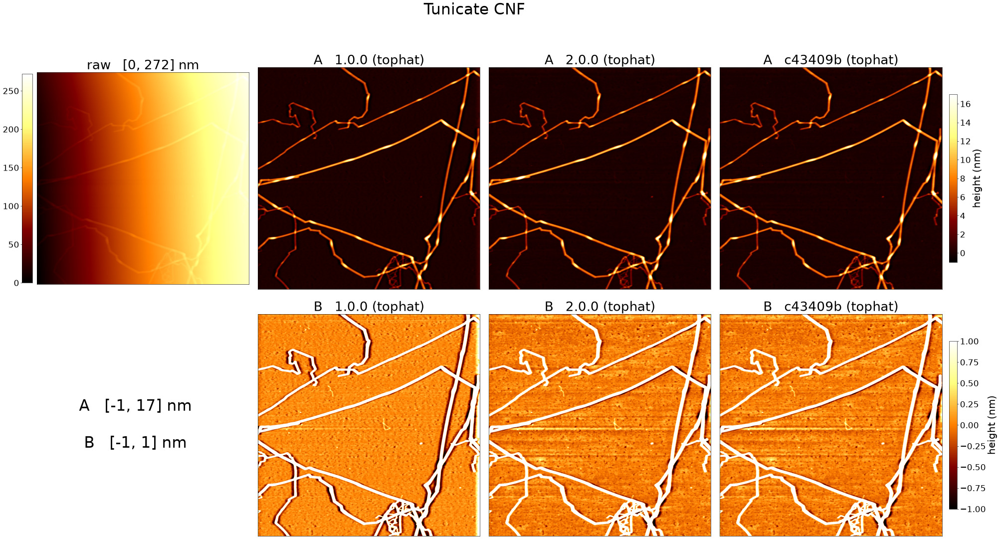](images/history/background_tophat_tunicate.jpg)

[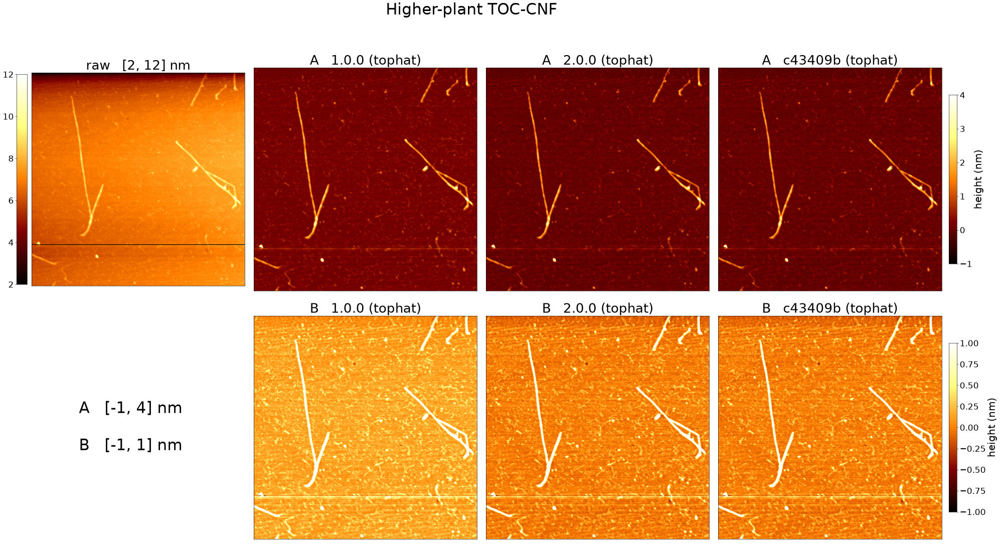](images/history/background_tophat_higherplant.jpg)

[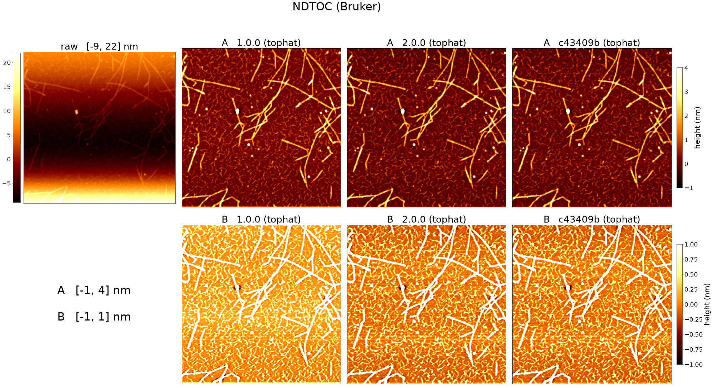](images/history/background_tophat_ndtoc.jpg)

1.0.0 の `tophat` は、生のスキャンに直径 25 px（`tophat_se_size`）の楕円の構造要素で
モルフォロジーのオープニング（`cv2.morphologyEx(..., cv2.MORPH_OPEN, ...)`）をかけ、
その結果を 1.1 節の Savitzky-Golay フィルターで各行に沿って平滑化し、差し引いていた。
2.0.0 からは、オープニングの前にスキャン全体に 2 次曲面をフィットして差し引き、
平滑化の後に足し戻し、最後に補正後の画像の中央値を差し引く
（`BGCalibrator._call_tophat`）。3 つのスキャンで、c43409b の補正後の画像は 2.0.0 と
同じである。

Tunicate のスキャンでは、1.0.0 の B 段で、生のスキャンが上がっていく側である右端に
沿って明るい帯が見える。2.0.0 にはこの帯はない。3 つのスキャンすべてで、1.0.0 の
B 段は 2.0.0 より全体に明るい。1.0.0 の背景は 0 より上にあり、2.0.0 は補正後の画像の
中央値を 0 にそろえるためである。

Tunicate のスキャンの 2.0.0 には横縞も見え、1.0.0 ではそれが淡い。これは生のスキャン
自体にある走査線ごとのずれで、2.0.0 が付け加えたものではない。1.0.0 は、このスキャンが
行に沿って急に上がっているためにその一部を取り除いていた。2.0.0 はオープニングの前に
その傾きを除くので、大部分を残す。この裏付けとなる測定値は
`scripts/make_history_figures.py --check` が表示する。

### 1.4 `spline1d`（2.0.0）

[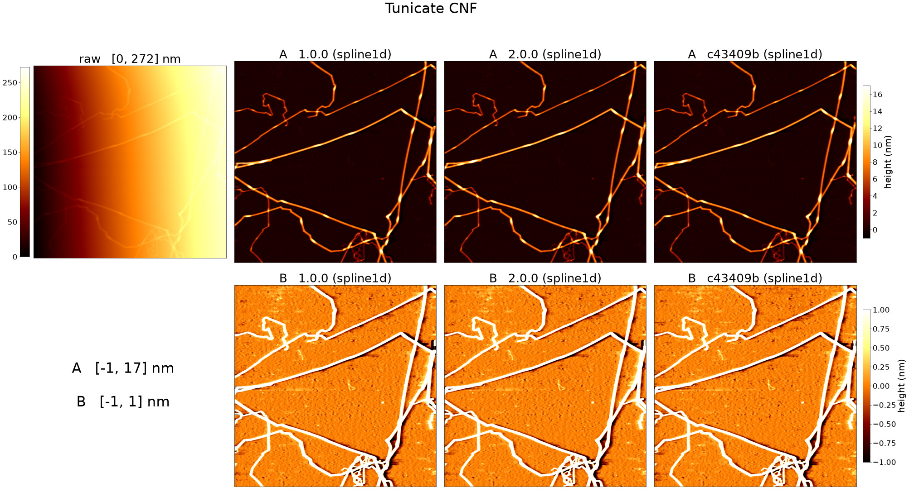](images/history/background_spline1d_tunicate.jpg)

[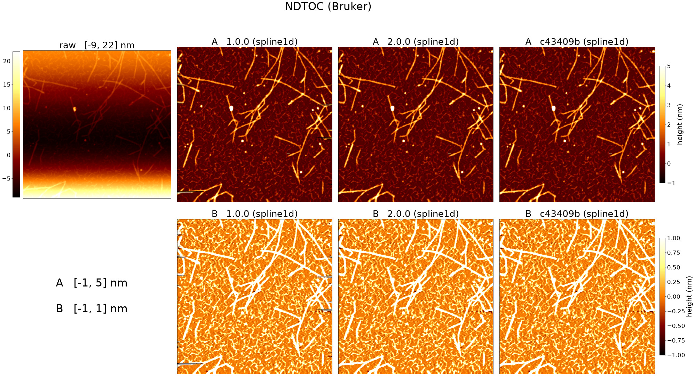](images/history/background_spline1d_ndtoc.jpg)

`spline1d` は、各行（`spline1d_axis = "x"`）のマスクした画素を、行に沿った 2 次の
スプライン補間で埋める。1.0.0 では、行の最初と最後の背景画素より外側を、いちばん外側の
2 つの背景画素を通る直線をスキャンの端まで延ばして埋めていた（`v1.0.0` の
`BGCalibrator._spline1d_fill`）。2.0.0 からは、埋める前に背景の画素に 2 次曲面を
フィットして差し引き、行の各端でいちばん外側の背景画素より外側の画素を、その端に
最も近い 31 個（`savgol_window`）の背景画素の平均値で埋め、曲面を足し戻す
（`BGCalibrator._call_spline1d`、`BGCalibrator._spline1d_fill`）。

1.0.0 では、3 つのスキャンすべてで、暗い短い横縞と明るい短い横縞が画像の左右の端から
入り込んでいる。NDTOC のスキャンで最も多い。2.0.0 と c43409b にはそれがない。1.2 節の
変更は `spline1d` にも及ぶ。

## 2. 二値化

二値化そのものが何を変えたかを示すため、どの版にも同じ補正後の画像、すなわち
c43409b が既定の設定で補正した画像を与える。最初の列はその画像を灰色で示し、続く各列は
ある版のマスクを青で示す。マスクが同一の版は 1 つの列を共有する。緑の円は、その版が
1 つ前の列のマスクに加えた成分を示す。これらのスキャンで成分を取り除いた版はない。二値化の設定（`wsize_localbin`、
`global_threshold`、`area_min`、`area_min_connecting`、`apply_no_connecting`、
`h_length`、`h_sratio`、`low_threshold`）の既定値は 3 つの版で同じである
（`ProcParams`）。

[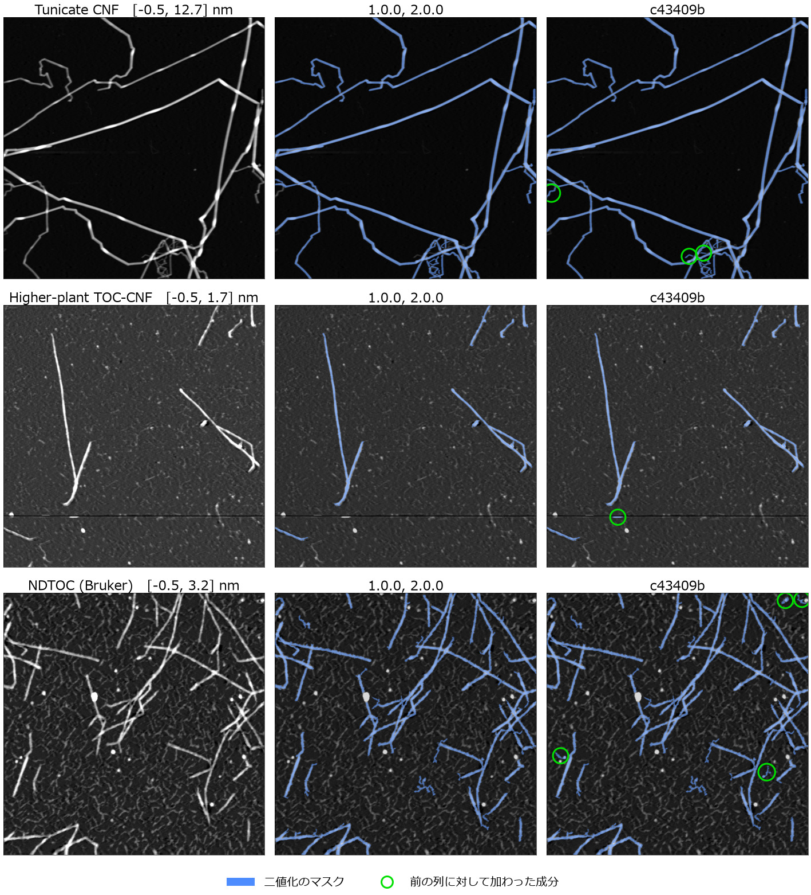](images/history/binarization.ja.jpg)

### 2.1 1.0.0 から 2.0.0 へ

1.0.0 と 2.0.0 の間で二値化のコードは変わったが、3 つのスキャンで両版のマスクは
同一である。

### 2.2 画素の格子に依存しない直線らしさ（未リリース、`3e67866`）

直線性フィルター（`Segmenter._remove_nonlinear_objects`）は、1000 画素未満の成分に
ついて、その輪郭上で Hough 変換が見つけた直線の合計が輪郭の `h_sratio` に満たない
とき、その成分を除く。コミット `3e67866` から、次の 3 点が異なる。

- 最大の差し渡し（`segmenter._max_extent_px`）が `h_length` 画素より短い成分は、
  判定をせずに除く。以前は外接矩形の長い辺を比べていた。
- 輪郭を求める前に、成分を 1 画素の余白を付けて切り出す。そのため、切り出した範囲の
  辺に重なる輪郭も見つかる。
- Hough 直線は、得票数がその角度 θ の |cos θ| と |sin θ| の大きいほうの
  `h_length` 倍を超えるときに合計に数える。以前は得票数が `h_length` 以上の直線を
  すべて数えていた。

2.0.0 と c43409b のマスクの違いは、すべてこの変更による。この変更の直前のコミットは
2.0.0 のマスクを、この変更のコミットは c43409b のマスクを出す。c43409b は、Tunicate の
スキャンで 3 つ、Higher-plant のスキャンで 1 つ、NDTOC のスキャンで 4 つの成分を加え、
取り除いた成分はない。Tunicate のスキャンでは、左端で枝分かれする淡いファイバーと、
下部の交差の脇にある淡く短い 2 つの断片である。NDTOC のスキャンでは、粒子で終わる
淡い 3 本の筋と、短い突起の付いた 1 つの粒子である。Higher-plant のスキャンで加わった
成分は、乱れた走査線の上にあり、ファイバーではない。下の図は、c43409b が加えた成分を
すべて、灰色の高さ画像の上に変化のないマスクを青で重ねて拡大したものである。

[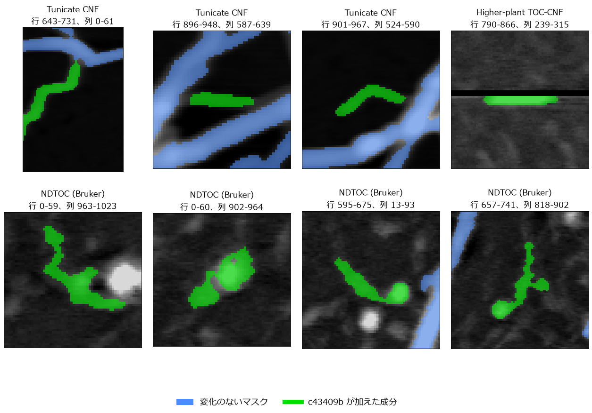](images/history/binarization_zoom.ja.png)

Tunicate のスキャンの左端の淡い枝は、1.0.0 では二値化され、2.0.0 で失われていた。
2.0.0 の二値化は、1.0.0 の補正後の画像ではこの枝を残し、2.0.0 と c43409b の補正後の
画像では取り除く。したがって、この枝は既定の背景補正の方式が変わったとき（1.1 節）に
失われた。c43409b の二値化は、3 つの補正後の画像のいずれでもこの枝を残す。

## 3. 細線化

細線化の中核の処理は変わっていない。どの版も、マスクを `skimage.morphology.thin` で
細くし、枝を刈った後に `skimage.morphology.skeletonize` をかける
（`Skeletonizer.__call__`）。変わったのはその前後の処理で、以下の各節がそれぞれを
扱う。

2 章と同じく、どの版にも同じ入力、すなわち c43409b の補正後の画像とそのマスクを
与える。`bp_height`、`branch_length`、`min_area` の既定値は 3 つの版で同じで、2.0.0 で
`max_loop_area` と `spur_length` が加わった（`ProcParams`）。この入力では 2.0.0 と
c43409b のスケルトンは同一で、1.0.0 と 2.0.0 の違いはすべて 4 つのコミットによる。
下の図はそれぞれを 1 列で示す。各パネルは、変化のないスケルトンを青で、その変更が
加えた画素を緑で、取り除いた画素をマゼンタで示し、変わった場所を黄色の円で囲む。
スキャン全体の大きさでは、これらの場所は数画素にしかならないので、以下の各節で、
その変更が最も大きく変えた場所を拡大して示す。

[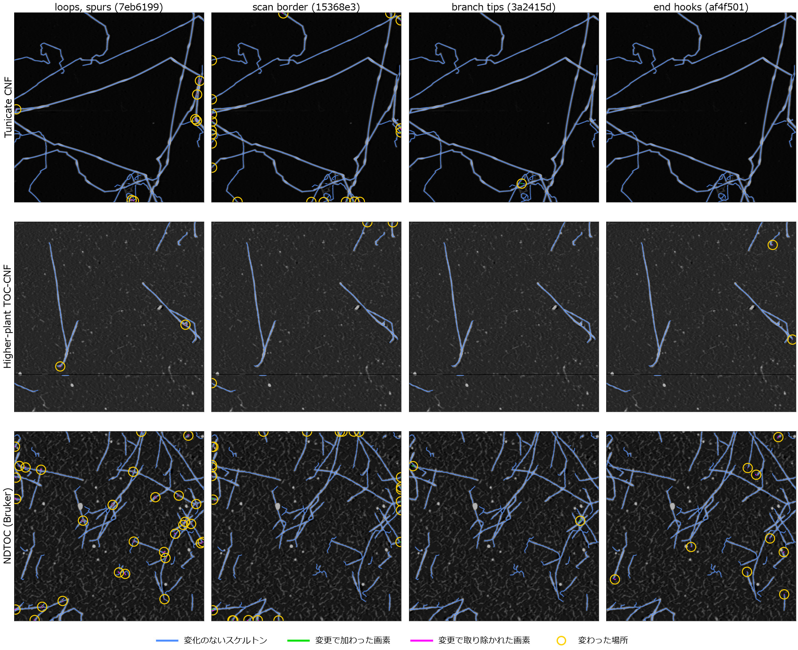](images/history/skeletonization.ja.jpg)

### 3.1 ループと短い枝（`7eb6199`）

`thin` は、マスクに穴があるところに小さな輪を残し、行き止まりの短い側枝を残すことも
ある。どちらも分岐点を増やし、追跡のときにファイバーを分断する。スケルトンは、
囲む背景が `max_loop_area`（100）画素以下の輪を、その内部が周囲の稜線の 0.3 倍より
低い場合を除いて埋め、埋めた部分をもう一度細くする（`collapse_skeleton_loops`）。
また、`spur_length`（12）画素以内で分岐点に達する行き止まりの枝を取り除く
（`prune_short_spurs`）。図の変化は、ファイバーの中や交差にある輪が 1 本の線に
まとめられたものと、短い側枝が取り除かれたものである。Tunicate のスキャンの下部に
ある 1 つの輪は、並んで走り両端で接する 2 本のファイバーの間の細い隙間を囲んでいる。
これも埋められ、そこで 2 本のファイバーは 1 本の線につながる
（`docs/validation.ja.md` §3.3）。図は、3 つのスキャンでこの変更がスケルトンの画素を
最も多く変えた 4 か所と、最後にその隙間を拡大したものである。

[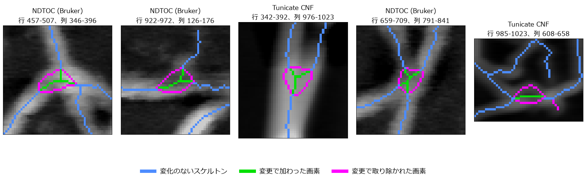](images/history/skeleton_zoom_1.ja.png)

### 3.2 スキャンの外へ出るファイバー（`15368e3`）

`thin` は画像の外側をすべて背景として扱ったため、スキャンの外へ出るファイバーの
スケルトンは、最後の数画素で脇へ曲がっていた。現在は、`thin` の前にマスクの縁を
12 画素外側へ繰り返して延ばす（`thin_ignoring_image_border`）。図の変化はすべて
スキャンの縁にあり、スケルトンの端がファイバーの向きのまま縁まで延びるように
なっている。図は、この変更がスケルトンの画素を最も多く変えた 4 か所を拡大したもので
ある。

[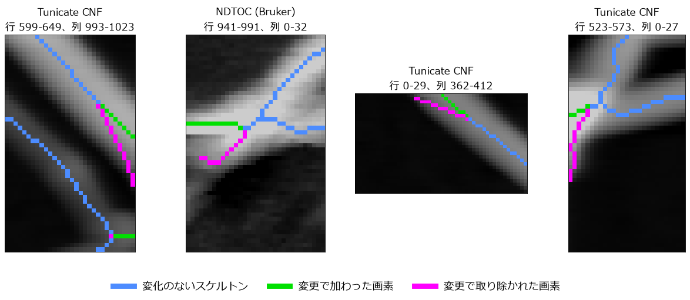](images/history/skeleton_zoom_2.ja.png)

### 3.3 枝の刈り込みとファイバーの先端（`3a2415d`）

枝の刈り込みは、短い腕をその端から分岐点に向かってたどる。以前は端の周りの小さな
切り出しの中でたどっていたため、切り出しの外へ続く腕が行き止まりに見え、削除されて
いた。現在は画像全体でたどる。図では、これにより淡い筋の上の短いスケルトンが、
Tunicate のスキャンで 1 か所、NDTOC のスキャンで 2 か所残る。図は、この 3 か所を
拡大したものである。

[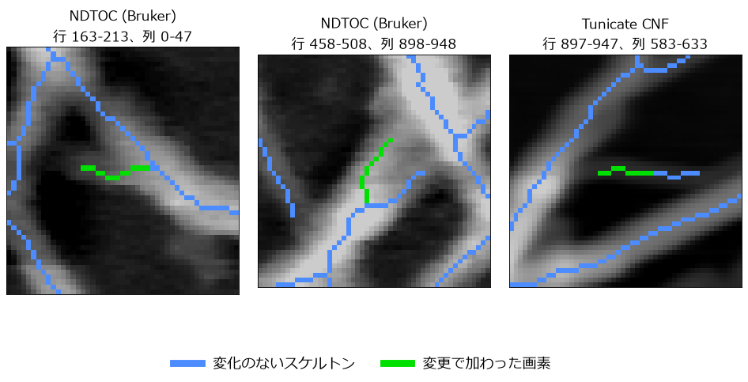](images/history/skeleton_zoom_3.ja.png)

### 3.4 ファイバーの端のフック（`af4f501`）

マスクがファイバーの先端に低い裾を含むと、`thin` はスケルトンの端を折り返させることが
ある。現在は、端から 12 画素以内で折り返し、隣のファイバー本体の中央値の半分より低い
画素を、その端から取り除く（`prune_terminal_hooks`）。図では、Higher-plant と NDTOC の
スキャンで、脇へ曲がるファイバーの端から数画素が消える。その多くは 1〜2 画素で、
NDTOC のスキャンの数か所は折り返すフックである。図は、この変更がスケルトンの画素を
最も多く変えた 4 か所を拡大したものである。

[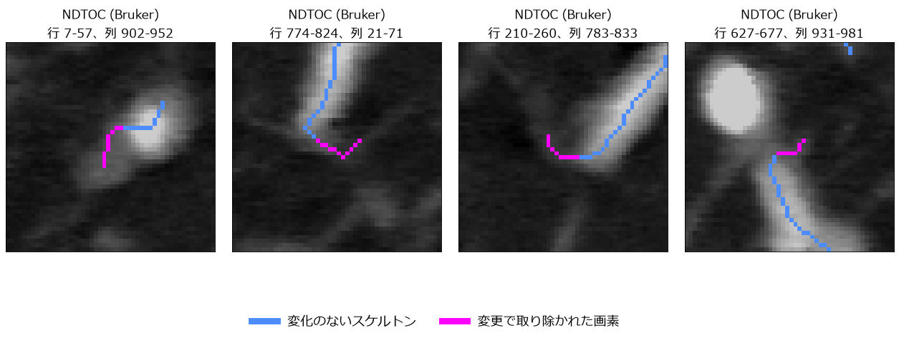](images/history/skeleton_zoom_4.ja.png)

## 4. 中心線とキンク検出

2 章・3 章と同じく、どの版にも同じ入力、すなわち c43409b の補正後の画像と
スケルトンを与える。キンクのしきい値 `kinkangle_deg` の既定値は、3 つの版とも 150° で
ある（`ProcParams`）。

図は、このソフトウェアの著者 2 人が 3 つのスキャンに手で付けたキンクの印
（`docs/validation.ja.md` §4.19）に対して各版を採点し、2 人とも明瞭とした印を基準と
する。そのような印に対応するキンク、または 2 人の他の印の近くにあるキンクは緑、
どの印にも対応しないキンクはマゼンタで描き、その版が見落とした明瞭な印を黄色の輪で
囲む。青で描いた線は、その版がキンクを判定する線である。キンクと印は、スキャンの
ファイバーの見かけ幅の中央値以内で対応させる。1.0.0 は幅を測らないため、どの版にも
同じ幅を使う。

[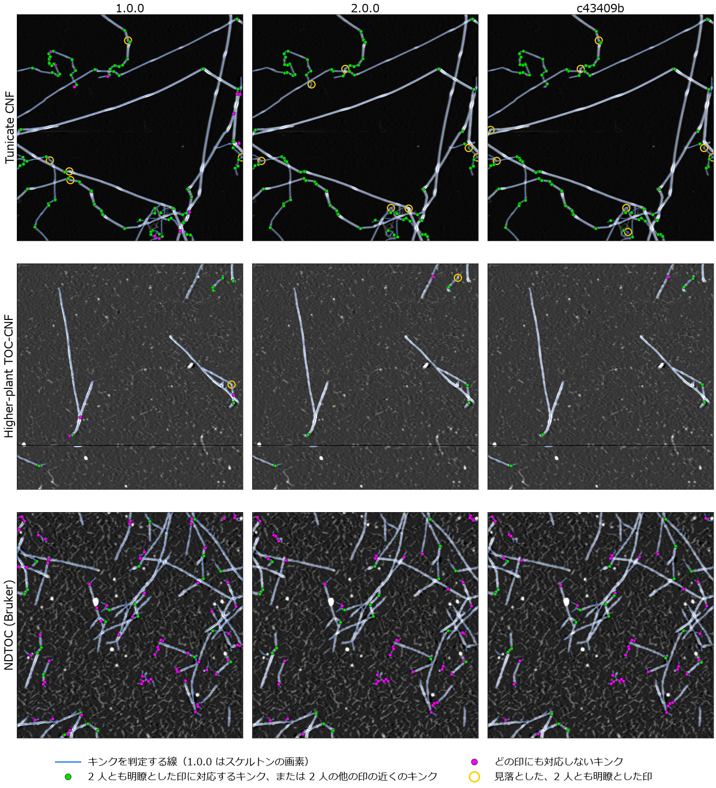](images/history/kinks.ja.jpg)

2 人とも明瞭とした 76 個の印に対して:

| 版 | 報告したキンク | 見つけた | 統合 | 見落とし | どの印にも対応しない |
|---|---|---|---|---|---|
| 1.0.0 | 185 | 69 | 1 | 6 | 83 |
| 2.0.0 | 147 | 67 | 1 | 8 | 49 |
| c43409b | 139 | 66 | 2 | 8 | 43 |

「見つけた」には、その幅の 1〜2 倍離れたキンクが見つけた印を含む。「統合」は、
その幅以内にある唯一のキンクが既に別の印に対応していたことを表す。この比較には、新しい版に
有利に働く点が 2 つある。著者は、新しい解析（バンドル形式 1.5）の中心線を描いた画像に
印を付けた。また、2.0.0 以降のキンクの規則は、この 3 つのスキャンで作られた。
スキャンごとの数と、それぞれの著者の印だけに対する数は
`scripts/make_history_figures.py --check` が表示する。

2.0.0 は、キンクを判定する線（4.1 節）と、それを判定する規則（4.2 節）の 2 つを
同時に変えた。同じ
追跡済みの断片の上で、それぞれの線をそれぞれの規則で判定すると、2 つを分けられる
（2 人とも明瞭とした印に対して）。

| 線 | 規則 | 報告したキンク | 見つけた | 見落とし | どの印にも対応しない |
|---|---|---|---|---|---|
| スケルトンの画素 | 折れ線（1.0.0） | 185 | 69 | 6 | 83 |
| スケルトンの画素 | 超過回転 | 218 | 68 | 7 | 113 |
| 半値中心線 | 折れ線（1.0.0） | 143 | 66 | 8 | 51 |
| 半値中心線 | 超過回転（2.0.0 以降） | 139 | 66 | 8 | 43 |

1 行目は 1.0.0、最後の行は c43409b である。スケルトンの画素は
`centerline_method = "skeleton_pixels"` が選ぶ線で、折れ線の規則は `v1.0.0` のものを
記録した線に当てた。

### 4.1 線: スケルトンの画素から半値中心線へ

1.0.0 は、スケルトンそのもの、すなわち 8 近傍のいずれかへしか進まないスケルトンの
画素の並びの上でキンクを判定していた。2.0.0 からは、追跡した各断片を半値中心線の
上に置く。スケルトンの各点を、ファイバーの見かけ幅 W の 4 分の 1 で平滑化した向きに
沿ってファイバーを横切る方向へ動かし、高さの断面が最大値の半分まで下がる 2 点の
中点に置く（`centerline.place_centerline`）。

下の図は、各スキャンで 2 人とも明瞭とした印を最も多く持つ中心線を選び、そのファイバー
を拡大したものである。左のパネルはスケルトンの画素と 1.0.0 のキンク、右のパネルは
中心線と c43409b のキンクを、上の図と同じ色分けで示し、印は黄色の × で示す。スケルトンの
画素はファイバーに沿って階段状に進み、NDTOC のスキャンの交差では枝分かれする。
中心線はファイバーの中央をなめらかに通る。

[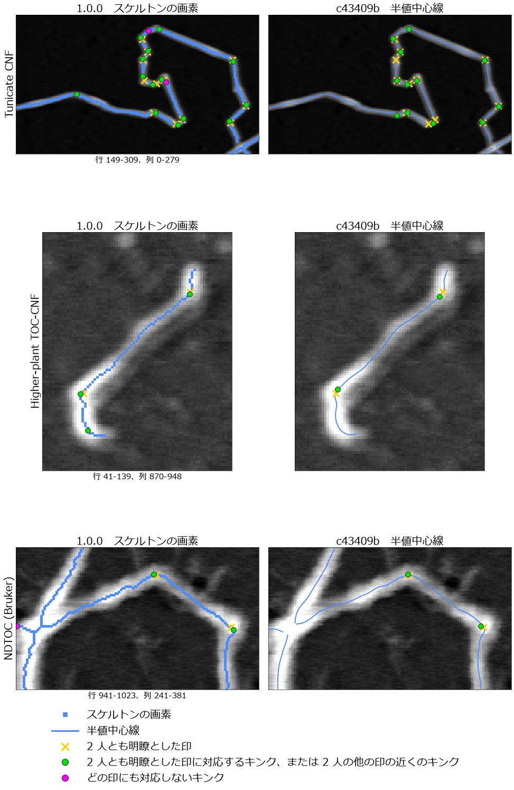](images/history/centerline.ja.png)

1.0.0 の折れ線の規則のまま、線をスケルトンの画素から中心線に替えると、どの印にも
対応しないキンクは 83 から 51 に減り、見つけた印は 69 から 66 に減る。Tunicate と
Higher-plant のスキャンで、どの印にも対応しない 1.0.0 のキンクは、交差やファイバーの
太い部分でスケルトンが二股に分かれるところ、スケルトンの端が曲がるところ、そして
著者が印を付けなかった一部の曲がりにある。

2.0.0 からは、GUI03・GUI04・`cli.py measure` がバンドルを読んでファイバーを計測する
のも中心線の上である。1.0.0 では、ファイバーの高さはスケルトンの画素での補正後の高さ、
長さはスケルトンの画素の並びの長さだった（`imp_tools.convert_track_to_distance`）。
半値中心線の上では、高さは各点の断面の山の頂の高さ、長さは各点を結んだ折れ線の長さで
ある（`centerline.polyline_distance`、`fiber_tracking_image._build_fiber`）。そのため、
これらのプログラムが報告する高さと長さも 2.0.0 で変わった。どちらも
[`gui04_measurements.ja.md`](gui04_measurements.ja.md) の 2.6 節と 2.7 節が説明する。

### 4.2 規則: 折れ線の角度から超過回転へ

1.0.0 は、スケルトンを分岐点で切り、各断片を追跡し、その画素の並びを、画素から
3 px（`threshold_distance`）以内に頂点が乗る折れ線へ再帰的に分けていた。折れ線の
内側の頂点はすべて候補で、その各頂点で両隣の頂点との角度を測り、それが 150° 以下なら
キンクとしていた（`v1.0.0` の `KinkDetector._binary_decompose_simple` と
`KinkDetector._detect_kink_from_decomposed_indices`）。

2.0.0 からは、ファイバーの見かけ幅 W の ±0.75 倍の範囲での曲がりから、両側の
ファイバー自身の曲率で説明できる分を引いた値が 180° − `kinkangle_deg` に達する折れを
キンクとし、端から 1.5 W 以内の折れは判定しない（`KinkDetector.judge_line`）。判定する
折れは、線の進行方向（向き）を W の 4 分の 1 で平滑化し、線に沿って 0.5 px ごとに
読んだものの上で探す（`_heading_profile`）。候補は 2 種類ある。1 つは曲率（向きの変化率）の
極大で、しきい値ちょうどの折れが折れの区間全体で持つ平均曲率の半分に達するもの。
もう 1 つは ±0.75 W の区間全体での曲がりの極大でしきい値に達するもので、0.75 W 以内に
1 つ目の種類の候補があればこちらは採らない。候補は超過回転がしきい値に届くときに残し、強い
ものから順に採り、すでに採った候補から 0.75 W 以内の候補は同じ折れとみなす
（`v2.0.0` の `KinkDetector.judge_line`）。現在の規則は
[`algorithms.ja.md`](algorithms.ja.md) §4 が説明する。

キンクとして保存する角度も変わった。1.0.0 は、折れ線の頂点で両隣の頂点となす角を
保存していた。2.0.0 からは、探針が頂点を丸める半幅より外側で、折れの両脇で読んだ線の
2 本の腕のなす内角を保存し（`_arm_interior_angle`）、そのキンクを決めた超過回転を
その横に保存する。2 人とも明瞭とした印のうち 1.0.0 と c43409b の両方が見つける 58 個
では、角度の中央値はほとんど動かない（122.7° と 122.3°）が、1 つ 1 つのキンクの角度は
動く。その差は四分位で −6.7°〜+3.6° で、最大で −58° と +49° に達する。

中心線の上では、新しい規則は同じ 66 個の印を見つけ、どの印にも対応しないキンクを
51 から 43 に、Tunicate のスキャンでは 7 から 0 に減らす。中心線の上で折れ線の規則が
報告し、どの印にも対応しないキンクは、著者が印を付けなかった丸い曲がり、ファイバーの
端や交差の近く、そして Higher-plant のスキャンのまっすぐなファイバーの上の 1 か所に
ある。新しい規則には中心線が必要である。スケルトンの画素の上では、どの印にも対応
しないキンクを 113 個報告し、そのうち 100 個は NDTOC のスキャンにあり、その多くは、
画素の並びが隣の列へ階段状にずれるまっすぐなファイバーの上にある。

NDTOC のスキャンでは、どの線と規則の組み合わせも、どの印にも対応しないキンクを多く
残す。c43409b では、その多くがファイバーの間をうねる淡い筋の上か、そのような筋が
ファイバーに合流するところにある。

### 4.3 2.0.0 から c43409b へ

2.0.0 以降、5 つのコミットがこれらのスキャンでキンクまたは中心線を変えた。

| コミット | 変更 | 見つけた | 見落とし | どの印にも対応しない |
|---|---|---|---|---|
| （2.0.0） | | 67 | 8 | 49 |
| `491750c` | 中心線を画像の内側に保つ | 67 | 8 | 49 |
| `5d493c4` | W を、断面の最高点ではなく、断面の底と、追跡点から登って最初に達する極大との中間の高さで読む（形式 1.4） | 66 | 9 | 45 |
| `d5460ea` | 太いファイバーの W を、ファイバーに合わせて広がる範囲で読む（形式 1.5） | 64 | 11 | 45 |
| `0476088` | 超過回転の一定の下限まで折れを探す。しきい値が選ぶ折れはしきい値によらなくなる（形式 1.6） | 66 | 8 | 44 |
| `7666493` | 各断面を追跡点の両側で対称に読む。中心線はファイバーを追跡した向きによらなくなる（形式 1.7） | 66 | 8 | 43 |

形式 1.6（`0476088`）は、4.2 節の候補の探し方を変えた。2.0.0 では、しきい値で探して
いた。曲がりと超過回転がしきい値に届く折れだけが候補になるため、バンドルにはその
1 つのしきい値が選ぶ折れしか残らなかった。`0476088` からは、超過回転の一定の下限
10°（`WEAK_BEND_FLOOR_DEG`。しきい値の超過回転のほうが小さければそちら。
`KinkDetector.weak_bend_floor`）まで探し、候補が達するべき曲率もこの下限から決める。
区間全体の曲がりの極大を採らないのは、0.75 W 以内により強い 1 つ目の種類の候補が
あるときだけになった。残した折れのうち、しきい値に届くものがキンクで、それだけが隣の
折れの腕を区切る。残りは、キンクを判定する範囲にあれば、弱い折れとして保存する。

形式 1.2 と 1.3 の変更は、これらのスキャンを変えない。1.2 は解析で中心線を選べる
ようにしたが、既定は半値中心線のままである。1.3 は中心線を物理的な幾何で置くが、
画素が正方形のこれらのスキャンでは画素の幾何と同じである。2.0.0 と c43409b の
一方だけが報告する 44 個のキンクのうち、28 個は同じ折れが数画素ずれて置かれたもの、
12 個は 2.0.0 にあって c43409b にないもの（Tunicate のスキャンで 5 個、NDTOC の
スキャンで 7 個、そのうち数個は淡い筋の上）、4 個は新しく加わったものである。
