# How the GUI01 algorithms changed

This document follows the analysis stages of GUI01 — background correction,
binarization, skeletonization, the fiber centerline, and kink detection —
from version 1.0.0 to the current code, and shows on the bundled test scans
what each change did. [`algorithms.md`](algorithms.md) explains what the
current code computes; this document explains how it came to compute that.

## How the figures are made

Every figure is drawn by `scripts/make_history_figures.py`. For each version
compared, the script takes that version's `lib/` from Git at a pinned commit
and runs it in a separate process with the defaults the version shipped with,
so each column shows what that version actually produced. From §2 on, every
version is given the same input to the stage shown, the output of the current
code's earlier stages, so a figure shows the change of that stage alone. The
scans are the three bundled test scans, shown whole:

| Scan | File |
|---|---|
| Tunicate CNF | `testdata_tunicateCNF/TunicateACTOCCNF.txt` |
| Higher-plant TOC-CNF | `testdata_higherplantTOC/_20250318-164122_T.ssp .txt` |
| NDTOC (Bruker) | `testdata_Bruker_txt/NDTOC250306.000.txt` |

The versions compared are:

| Label | Commit | Date |
|---|---|---|
| 1.0.0 | `3c28dec` (tag `v1.0.0`) | 2026-07-08 |
| 2.0.0 | `f9c1ad8` (tag `v2.0.0`) | 2026-09-17 |
| c43409b | `c43409b` (unreleased) | 2026-11-09 |

The figures in this document are reduced. Running
`.venv\Scripts\python.exe scripts\make_history_figures.py --full` writes the
same figures with about one screen pixel per scan pixel to `.tmp/history/full/`, and
`--check` prints the measurements behind the statements below that attribute
a change to one commit or explain where it comes from.

## 1. Background correction

Each figure has two rows. Row A shows the raw scan, with its own colour range,
and the calibrated image of each version, all three at the automatic display
range `lib.ui_tools.compute_auto_vrange` computes from the c43409b result. Row
B shows the same calibrated images at −1 to +1 nm, where what is left of the
background becomes visible and the fibers saturate to white.

### 1.1 The default method: `inpaint` to `trendfill` (2.0.0)

[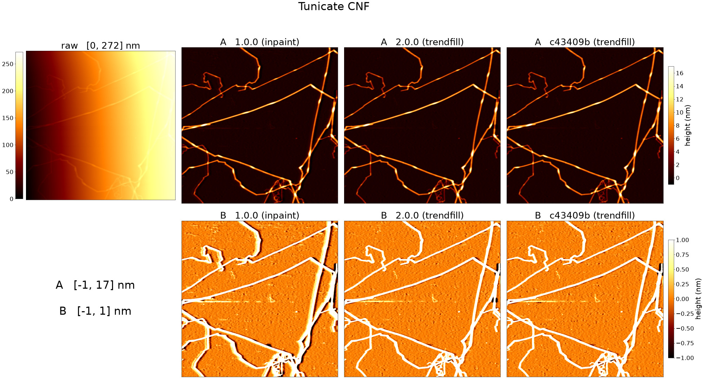](images/history/background_default_tunicate.jpg)

[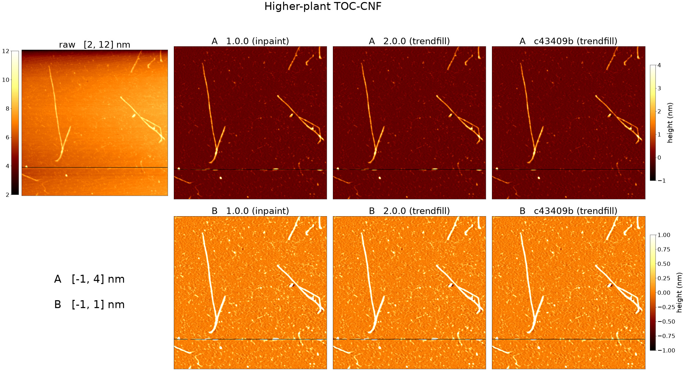](images/history/background_default_higherplant.jpg)

[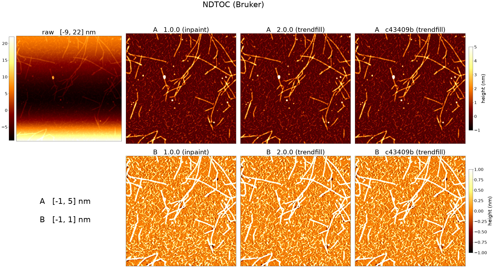](images/history/background_default_ndtoc.jpg)

In 1.0.0 the default method was `inpaint`. It masked the fibers, filled the
masked pixels with OpenCV's Navier-Stokes inpainting
(`cv2.inpaint(..., 3, cv2.INPAINT_NS)`), smoothed the filled image along each
row with a Savitzky-Golay filter (window 31 px, polynomial order 1), and
subtracted the result from the scan (`BGCalibrator._bg_generate` at
`v1.0.0`).

From 2.0.0 the default is `trendfill`. It first fits a second-order surface
to the background pixels (`BGCalibrator._fit_trend_surface`) and subtracts it,
fills the masked pixels from the nearest background pixel, applies the same
Savitzky-Golay smoothing, and adds the surface back (`BGCalibrator._bg_generate`).
The smoothing defaults, a 31 px window and order 1, are the same in both
versions (`ProcParams`).

On the tunicate scan, whose raw height rises steeply from left to right, row B
of 1.0.0 shows along the fibers a dark band on one side, lower than the
surrounding background, and a bright band on the other, higher than it. In
2.0.0 and c43409b these bands are largely gone. On the higher-plant and NDTOC
scans no difference between the three versions is visible in either row. The
analysis that led to the change is recorded in the 2.0.0 section of
[`CHANGELOG.md`](../CHANGELOG.md).

### 1.2 Narrow fibers along a scan axis (unreleased, `e53ec48`)

This change is seen in the figures of §1.1. The fiber mask that `trendfill`
and `spline1d` share is built from the height steps along the rows and along the
columns. A narrow ridge whose crest falls on a single pixel, with no flat run
between its rise and its fall, was accepted only when the run from the rise to
the fall along the scan line was longer than `noise_detect_factor` pixels.
Along a fiber that runs close to one scan axis, the lines of the other axis
cross it at right angles, and that run is the fiber's width, so a fiber
narrower than `noise_detect_factor` pixels was never masked and its height was
subtracted together with the background. Since commit `e53ec48` such short
ridges are kept in the mask when, together with the ridges beside them, they
form an object longer than `noise_detect_factor` pixels
(`BGCalibrator._lined_up_marks`).

On the tunicate scan this shows at the right edge, a little below the middle,
where a fiber runs nearly vertically: in 1.0.0 and 2.0.0 part of it is
subtracted and appears black in row B, while in c43409b the fiber is
continuous. Running the commits before and after this change confirmed that
it is the change that removes the black section. On the higher-plant and NDTOC
scans the calibrated images of 2.0.0 and c43409b differ in places, but no
difference is visible in either row of the figures.

### 1.3 `tophat` (2.0.0)

[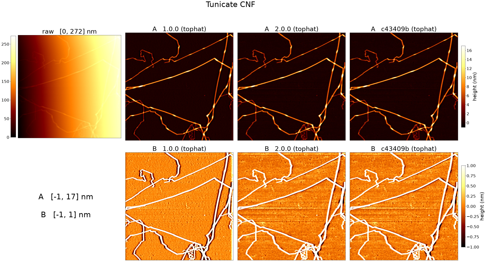](images/history/background_tophat_tunicate.jpg)

[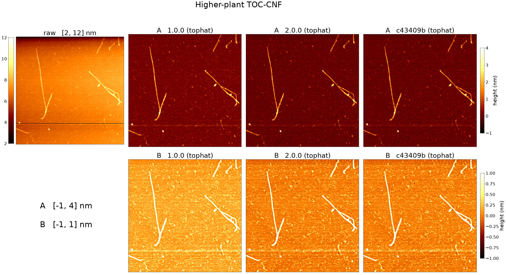](images/history/background_tophat_higherplant.jpg)

[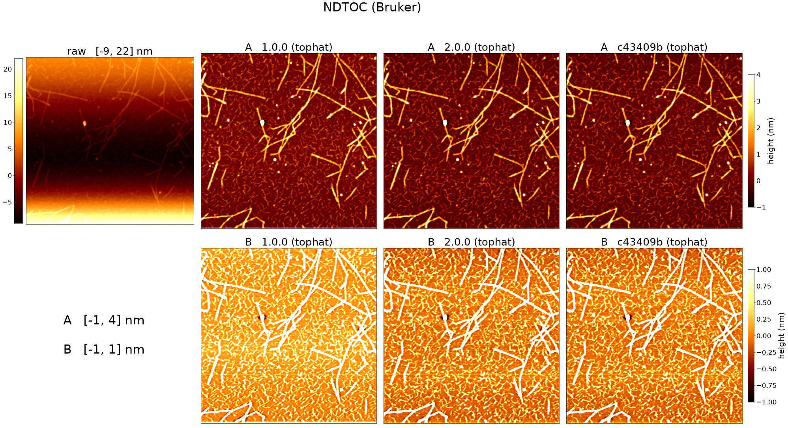](images/history/background_tophat_ndtoc.jpg)

In 1.0.0 `tophat` applied a morphological opening
(`cv2.morphologyEx(..., cv2.MORPH_OPEN, ...)`) with an elliptical structuring
element 25 px across (`tophat_se_size`) to the raw scan, smoothed the result
along each row with the Savitzky-Golay filter of §1.1, and subtracted it. From
2.0.0 it fits a second-order surface to the whole scan and subtracts it before
the opening, adds it back after the smoothing, and finally subtracts the median
of the calibrated image (`BGCalibrator._call_tophat`). On the three scans
c43409b gives the same calibrated images as 2.0.0.

On the tunicate scan, row B of 1.0.0 shows a bright band down the right edge,
the side the raw scan rises towards; 2.0.0 has no such band. On all three
scans row B of 1.0.0 is lighter overall than that of 2.0.0: the background of
1.0.0 lies above zero, while 2.0.0 sets the median of the calibrated image to
zero.

The tunicate scan of 2.0.0 also shows horizontal stripes, which are fainter in
1.0.0. They are line-to-line offsets of the raw scan itself, not something
2.0.0 adds. 1.0.0 removed part of them because this scan rises steeply along
its rows; 2.0.0 removes that slope before the opening and keeps most of them.
`scripts/make_history_figures.py --check` prints the measurements behind this.

### 1.4 `spline1d` (2.0.0)

[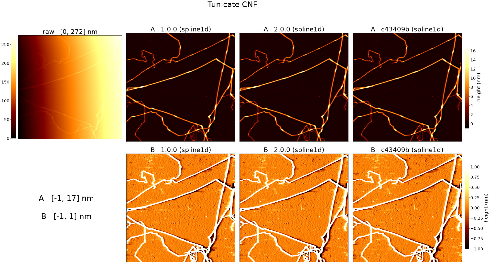](images/history/background_spline1d_tunicate.jpg)

[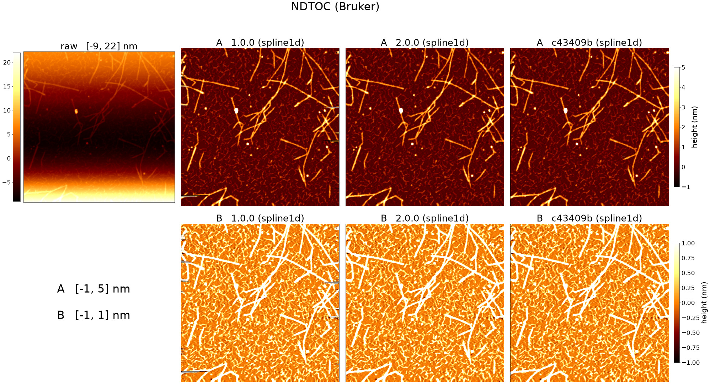](images/history/background_spline1d_ndtoc.jpg)

`spline1d` fills the masked pixels of each row (`spline1d_axis = "x"`) by
second-order spline interpolation along the row. In 1.0.0, beyond the first
and the last background pixel of a row, it extended the straight line through
the two outermost background pixels to the edge of the scan
(`BGCalibrator._spline1d_fill` at `v1.0.0`). From 2.0.0 a second-order
surface is fitted to the background pixels and subtracted before the fill, the
pixels beyond the outermost background pixel at each end of a row take the
mean of the 31 (`savgol_window`) background pixels nearest that end, and the
surface is added back (`BGCalibrator._call_spline1d`,
`BGCalibrator._spline1d_fill`).

In 1.0.0 short horizontal streaks, dark and bright, run into the image from the
left and the right edges on all three scans, most of them on the NDTOC scan.
2.0.0 and c43409b show none. The change of §1.2 also applies to `spline1d`.

## 2. Binarization

To show what the binarization itself changed, every version is given the same
calibrated image: that of c43409b at its default settings. The first column shows
that image in grey; each further column shows a version's mask in blue, and
versions whose masks are identical share a column. A green circle marks a
component the version adds to the mask of the column before it, and a magenta
circle one it removes; on these scans no version removes one. The defaults
of the binarization settings (`wsize_localbin`, `global_threshold`,
`area_min`, `area_min_connecting`, `apply_no_connecting`, `h_length`,
`h_sratio`, `low_threshold`) are the same in all three versions (`ProcParams`).

[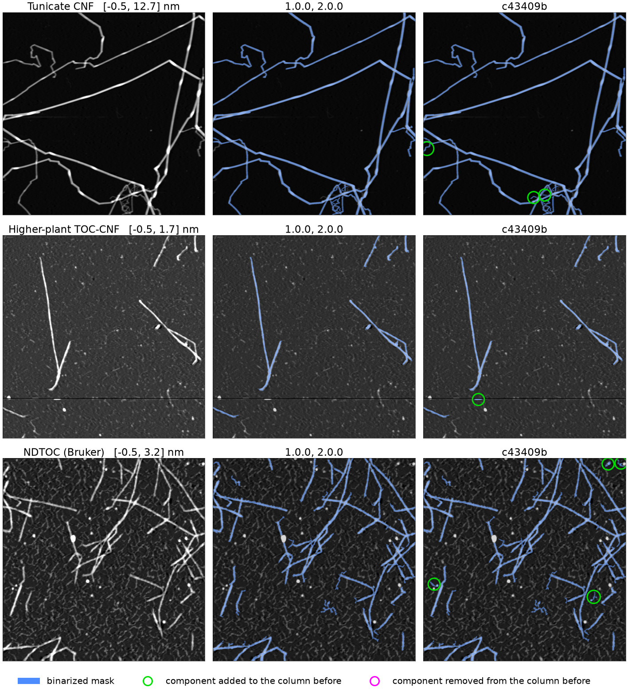](images/history/binarization.jpg)

### 2.1 1.0.0 to 2.0.0

The binarization code changed between 1.0.0 and 2.0.0, but on the three scans
the masks of the two versions are identical.

### 2.2 Line-likeness independent of the pixel grid (unreleased, `3e67866`)

The linearity filter (`Segmenter._remove_nonlinear_objects`) removes a
component of fewer than 1000 pixels when the straight lines a Hough transform
finds on its outline add up to less than `h_sratio` of the outline. Since
commit `3e67866` it differs in three places:

- A component is removed without the test when its largest extent
  (`segmenter._max_extent_px`) is shorter than `h_length` pixels; before, the
  longer side of its bounding box was compared.
- The component is cropped with a one-pixel margin before its outline is
  found, so the outline lying on the sides of the crop is found too.
- A Hough line counts towards the total when its votes exceed `h_length`
  times the larger of |cos θ| and |sin θ| of its angle θ; before, every line
  with at least `h_length` votes counted.

All differences between the masks of 2.0.0 and c43409b come from this change:
the commit before it gives the masks of 2.0.0, and the commit itself those of
c43409b. c43409b adds three components on the tunicate scan, one on the
higher-plant scan and four on the NDTOC scan, and removes none. On the
tunicate scan they are a faint fiber branching off at the left edge and two
short faint pieces beside a crossing near the bottom; on the NDTOC scan, three
faint strands ending in particles and one particle with a short protrusion. On
the higher-plant scan the added component lies on the disturbed scan line and
is not a fiber.

The faint branch at the left edge of the tunicate scan was binarized by 1.0.0
and lost in 2.0.0. The binarization of 2.0.0 keeps it on the calibrated image
of 1.0.0 and removes it on those of 2.0.0 and c43409b, so it was lost when the
default background method changed (§1.1). The binarization of c43409b keeps it
on all three calibrated images.

## 3. Skeletonization

The thinning itself has not changed: every version thins the mask with
`skimage.morphology.thin` and, after pruning branches, applies
`skimage.morphology.skeletonize` (`Skeletonizer.__call__`). What changed are
the steps around it, one per subsection below.

As in §2, every version is given the same input: the calibrated image of
c43409b and its mask. The defaults of `bp_height`, `branch_length` and
`min_area` are the same in all three versions; 2.0.0 adds `max_loop_area`
and `spur_length` (`ProcParams`). On this input 2.0.0 and c43409b give
identical skeletons, and every difference between 1.0.0 and 2.0.0 comes from
four commits, one column each in the figure below. Each panel shows the
skeleton after the change in blue, the pixels the change added in green and
those it removed in magenta, with a yellow circle around each place that
changed. At the size of a whole scan these places are a few pixels across;
the figure written by `--full` shows them.

[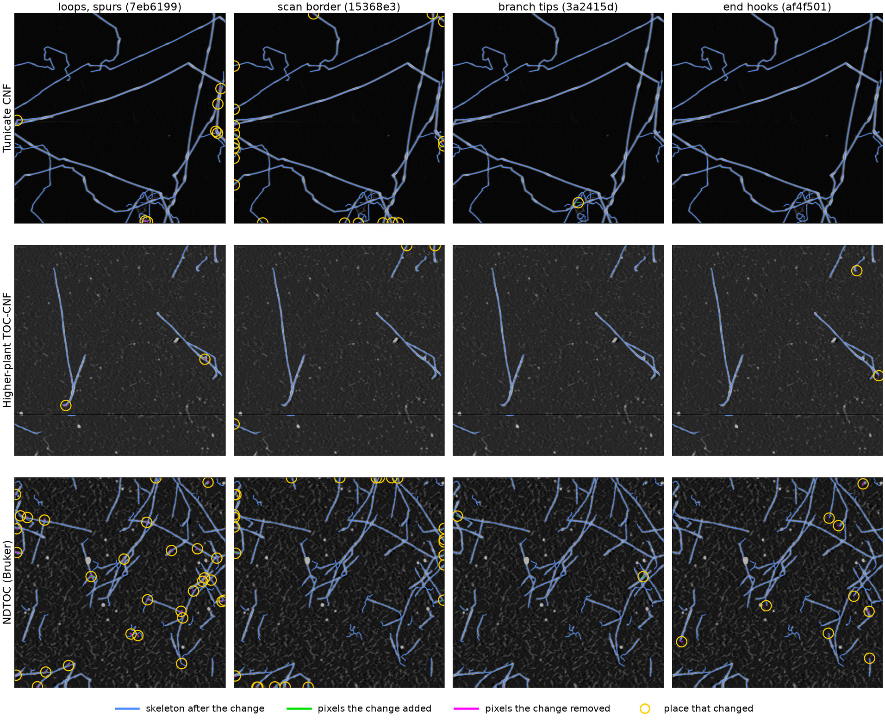](images/history/skeletonization.jpg)

### 3.1 Loops and spurs (`7eb6199`)

Thinning leaves a small ring wherever the mask holds a hole, and it can leave
short dead-end side branches; both add branch points, which split a fiber
when it is traced. The skeleton now fills a ring that
encloses at most `max_loop_area` (100) pixels of background, unless its
interior is lower than 0.3 times the surrounding ridge, and thins the filled
patch again (`collapse_skeleton_loops`); and it removes a dead-end branch that
reaches a branch point within `spur_length` (12) pixels
(`prune_short_spurs`). In the figure the changes are rings inside fibers and
at crossings collapsed into one line, and short side branches removed. One
ring near the bottom of the tunicate scan encloses the narrow gap between two
fibers that run side by side and touch at both ends; it is filled too, and the
two fibers are joined into one line there (`docs/validation.md` §3.3).

### 3.2 Fibers leaving the scan (`15368e3`)

Thinning treated everything outside the image as background, so the
skeleton of a fiber running off the scan turned aside over its last pixels.
The mask is now extended outward by repeating its border 12 pixels before
thinning (`thin_ignoring_image_border`). In the figure the changes all lie on
the edges of the scans, where the end of a skeleton now runs on to the edge
in the direction of its fiber.

### 3.3 Fiber tips in branch pruning (`3a2415d`)

Branch pruning follows a short arm from its end towards a branch point. It
used to follow it inside a small crop around the end, so an arm that ran on
past the crop looked like a dead end and was deleted. It now follows the arm
over the whole image. In the figure this keeps a short piece of skeleton on a
faint strand once on the tunicate scan and twice on the NDTOC scan.

### 3.4 Hooks at fiber ends (`af4f501`)

Where the mask admits a low skirt at a fiber tip, thinning can curl the end of
the skeleton back on itself. The skeleton now loses the pixels of such an end
that turn back within 12 pixels of it and lie lower than half the median of
the fiber body next to them (`prune_terminal_hooks`). In the figure a few
pixels disappear from fiber ends that turn aside on the higher-plant and NDTOC
scans; most are one or two pixels, and a few on the NDTOC scan are hooks that
bend back.

## 4. Centerline and kink detection

As in §2 and §3, every version is given the same input: the calibrated image
and the skeleton of c43409b. The kink threshold `kinkangle_deg` defaults to
150° in all three versions (`ProcParams`).

The figure scores each version against kinks two authors of this software
marked by hand on the three scans (`docs/validation.md` §4.19), with the
reference made of the marks both of them call clear. A kink is drawn green
when it matches such a mark or lies near another of their marks, magenta when
it matches no mark, and a clear mark the version misses is ringed in yellow.
The line drawn in blue is the line the version judges kinks on. A kink matches
a mark within the median apparent width of the scan's fibers, the same width
for every version, because 1.0.0 measures no width.

[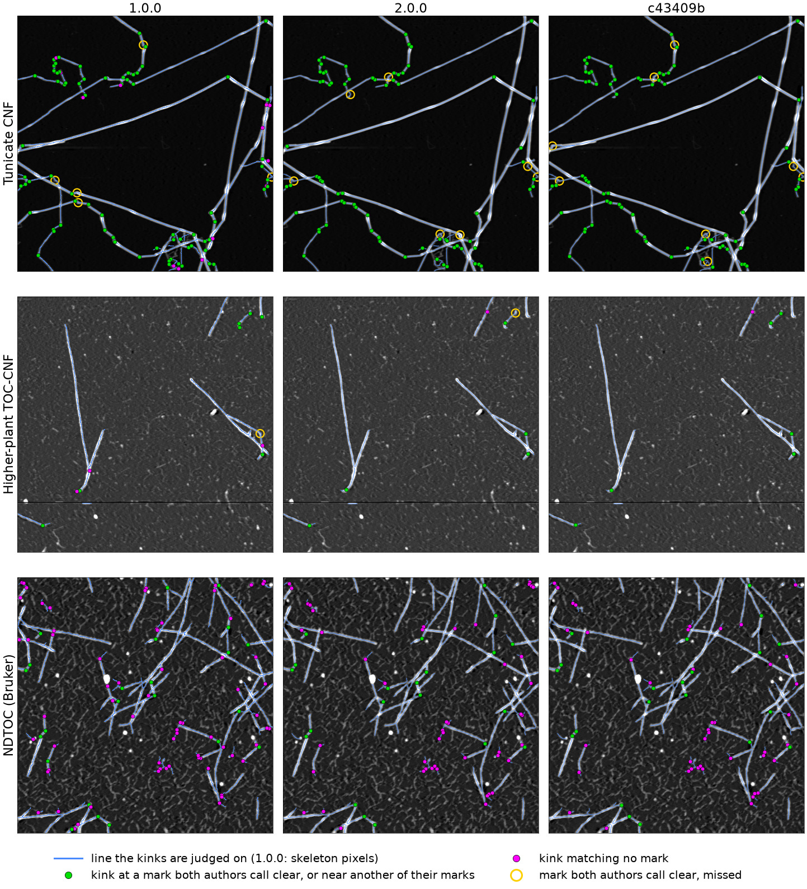](images/history/kinks.jpg)

Against the 76 marks both authors call clear:

| Version | Kinks reported | Found | Merged | Missed | Matching no mark |
|---|---|---|---|---|---|
| 1.0.0 | 185 | 69 | 1 | 6 | 83 |
| 2.0.0 | 147 | 67 | 1 | 8 | 49 |
| c43409b | 139 | 66 | 2 | 8 | 43 |

"Found" includes marks found by a kink one to two such widths away; "merged"
means that the only kink within that width had already matched another mark. Two things
favour the later versions in this comparison: the authors marked images on
which the centerlines of a later analysis (bundle format 1.5) were drawn, and
the kink rule of 2.0.0 and later was developed on these three scans.
`scripts/make_history_figures.py --check` prints the counts per scan and
against each author's marks alone.

2.0.0 changed two things at once: the line kinks are judged on (§4.1) and
the rule that judges them (§4.2). Judging each line by each rule, on the same
traced pieces, separates the two (marks both authors call clear):

| Line | Rule | Kinks reported | Found | Missed | Matching no mark |
|---|---|---|---|---|---|
| skeleton pixels | polyline (1.0.0) | 185 | 69 | 6 | 83 |
| skeleton pixels | excess turning | 218 | 68 | 7 | 113 |
| half-maximum centerline | polyline (1.0.0) | 143 | 66 | 8 | 51 |
| half-maximum centerline | excess turning (2.0.0 and later) | 139 | 66 | 8 | 43 |

The first row is 1.0.0 and the last c43409b; the skeleton pixels are the line
`centerline_method = "skeleton_pixels"` selects, and the polyline rule is
that of `v1.0.0` applied to the recorded lines.

### 4.1 The line: from the skeleton pixels to the half-maximum centerline

1.0.0 judged kinks on the skeleton itself: the chain of skeleton pixels, which
steps only to one of its eight neighbours. From 2.0.0 each traced piece is
placed on its half-maximum centerline: every skeleton point is moved across
the fiber to the midpoint of the two points where the height cross-section
falls to half its maximum, along a direction smoothed over a quarter of the
fiber's apparent width W (`centerline.place_centerline`).

The figure below enlarges one fiber of each scan, chosen as the centerline
with the most marks both authors call clear; the left panel shows the
skeleton pixels with the kinks of 1.0.0, the right one the centerline with
the kinks of c43409b, coloured as in the figure above, with the marks as
yellow crosses. The skeleton pixels run in steps along the fiber and branch
at the crossing on the NDTOC scan; the centerline runs smoothly along the
middle of the fiber.

[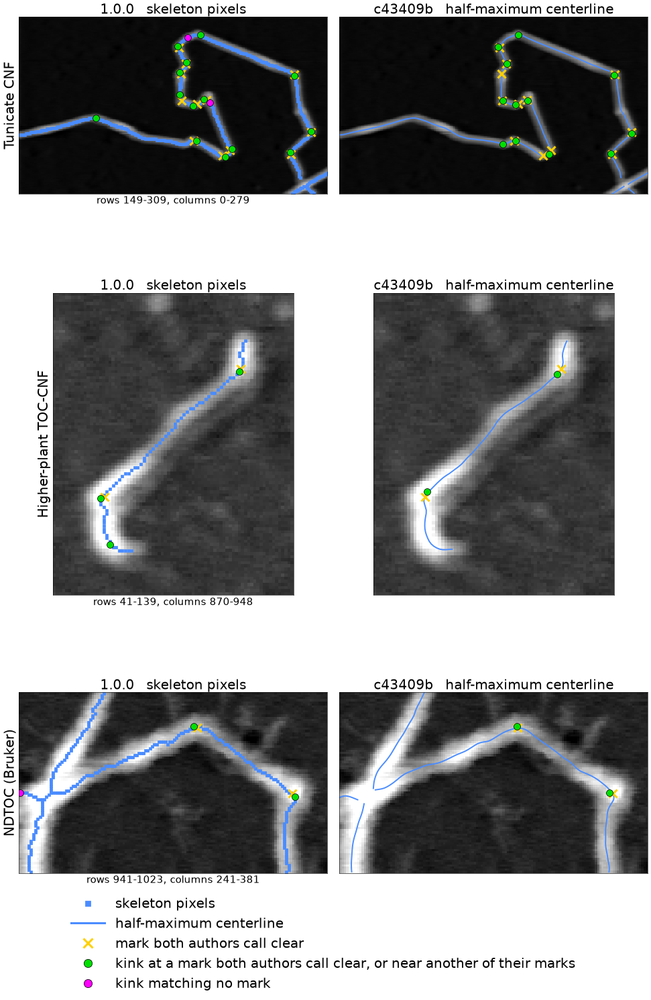](images/history/centerline.png)

With the polyline rule of 1.0.0, moving from the skeleton pixels to the
centerline lowers the kinks that match no mark from 83 to 51, and the marks
found from 69 to 66. The kinks of 1.0.0 that match no mark on the tunicate and
higher-plant scans lie where the skeleton splits around a crossing or a wide
part of a fiber, where its end curls, and on some bends the authors did not
mark.

### 4.2 The rule: from polyline angles to excess turning

1.0.0 cut the skeleton at its branch points, traced each piece, and split its
pixel chain recursively into a polyline whose points lie within 3 px
(`threshold_distance`) of the chain. At each inner vertex of the polyline it
measured the angle between the neighbouring vertices and reported a kink when
the angle was 150° or less (`KinkDetector._binary_decompose_simple` and
`KinkDetector._detect_kink_from_decomposed_indices` at `v1.0.0`).

From 2.0.0 a bend is a kink when its turning within ±0.75 W of the fiber's
apparent width W, less what the fiber's own curvature on either side accounts
for, reaches 180° minus `kinkangle_deg`; bends within 1.5 W of an end are not
judged
(`KinkDetector.judge_line`). [`algorithms.md`](algorithms.md) §4 explains the
rule as it is now.

On the centerline the new rule finds the same 66 marks and lowers the kinks
that match no mark from 51 to 43, on the tunicate scan from 7 to none. The
kinks of the polyline rule on the centerline that match no mark lie on rounded
bends the authors did not mark, near fiber ends and crossings, and once on a
straight fiber of the higher-plant scan. The new rule needs the centerline: on
the skeleton pixels it reports 113 kinks that match no mark, 100 of them on
the NDTOC scan, many of them on straight fibers whose pixel chain steps from
one column to the next.

On the NDTOC scan every line and rule leaves many kinks that match no mark;
for c43409b most of them lie on faint strands that wander between the fibers,
or where such a strand meets a fiber.

### 4.3 From 2.0.0 to c43409b

Five commits since 2.0.0 change the kinks or the centerline on these scans:

| Commit | Change | Found | Missed | Matching no mark |
|---|---|---|---|---|
| (2.0.0) | | 67 | 8 | 49 |
| `491750c` | the centerline is kept within the image | 67 | 8 | 49 |
| `5d493c4` | W is read at the level halfway between a cross-section's base and the first maximum uphill from the track point, instead of its highest point (format 1.4) | 66 | 9 | 45 |
| `d5460ea` | W of a wide fiber is read over a range that grows with the fiber (format 1.5) | 64 | 11 | 45 |
| `0476088` | bends are searched down to a fixed floor of excess turning, so which bends a threshold selects does not depend on the threshold (format 1.6) | 66 | 8 | 44 |
| `7666493` | each cross-section is read symmetrically about the track point, so the centerline does not depend on the direction a fiber was traced in (format 1.7) | 66 | 8 | 43 |

The format 1.2 and 1.3 changes do not change these scans: 1.2 lets the
analysis choose the centerline and keeps the half-maximum centerline as the
default, and 1.3 places the centerline in physical geometry, which is the
pixel geometry on these square-pixel scans. Of the 44 kinks that only one of
2.0.0 and c43409b reports, 28 are the same bend placed a few pixels apart, 12
kinks of 2.0.0 are gone (5 on the tunicate scan, 7 on the NDTOC scan, several
of these on faint strands), and 4 are new.
