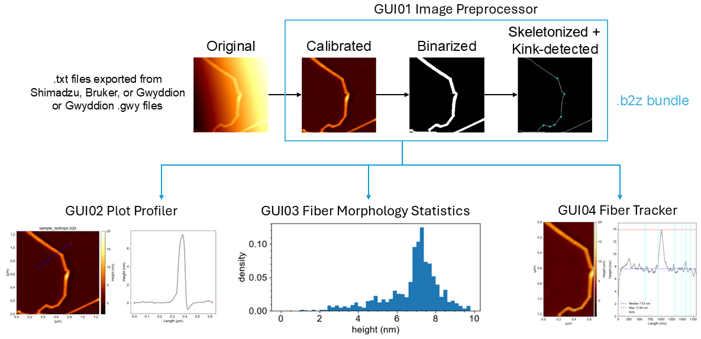

# Summary

Atomic force microscopy (AFM) records the height topography of individual
nanofibers [@Mayumi2026]. `AFM Nanofiber Analyzer` is a Python toolkit that
turns such height scans into per-fiber measurements. It reads AFM height
images exported as text/CSV or stored in native Gwyddion `.gwy` files, removes
instrument background, segments and skeletonizes the fibers, detects sharp
bends ("kinks"), and reports per-fiber statistics such as length, height, and
kink geometry (\autoref{fig:pipeline}).

The same analysis is exposed through a tkinter launcher with five interactive
tools and a command-line interface for batch processing, both built on one
shared analysis library. Results are written as one compressed bundle
per input (`.b2z`) whose keys, shapes, units, and coordinate convention are
governed by an executable schema validated when the bundle is written and
before it is measured.

# Statement of need

Studies of nanocellulose compare preparations by the heights of fibers measured
on AFM images [e.g., @Ito2025; @Mayumi2026]. Defects along the fibers matter as
well: preparations differ in how many and how large defects their fibers carry
[@Ito2025], and deep dents on the fiber surface induce kinking and fragmentation
[@Ito2022]. General-purpose scanning-probe software such as Gwyddion
[@Necas2012] provides image-level processing, including grain and particle
analysis. Dedicated fiber-tracking software does exist — most prominently
FiberApp [@Usov2015] — but it runs on the proprietary MATLAB platform and is
built around semi-automatic tracking in which the user initializes each fiber.

`AFM Nanofiber Analyzer` analyzes whole scans without per-fiber input and
measures the height and kinks along each traced fiber segment; segments split at
crossings and junctions can then be joined or excluded in the Fiber Tracker. It
is built as a documented pipeline on the scientific Python stack — NumPy [@Harris2020],
SciPy [@Virtanen2020], scikit-image [@vanderWalt2014], OpenCV [@Bradski2000],
lmfit [@Newville2014], and Matplotlib [@Hunter2007]. It grew out of
project-specific research scripts [@Ito_afm_image] for background calibration,
segmentation, skeletonization, and kink detection, and turns them into a
maintained, tested library with both interactive and batch front ends. Its
processing has since diverged from those scripts, so its results can differ from
the values published with them; the changelog marks the changes that alter
results from version 1.0.0 on. It gives researchers a scriptable batch interface
and a bundle format whose layout is versioned, documented, and validated when a
bundle is written and before it is measured.

# State of the field

Gwyddion [@Necas2012] is a modular, open-source package for scanning probe
microscopy data processing, with functions for levelling and background
subtraction, grain and particle analysis, and other image-level operations. Its
grain analysis reports characteristics of each marked grain as a whole, such as
its projected area, height statistics, volume, and boundary length; this project
instead follows each fiber along its length and reports the height and kinks
along it. This project reads Gwyddion's native `.gwy` files and its text
exports, so images can be levelled in Gwyddion and then analyzed here.

FiberApp [@Usov2015] tracks fibrous objects in microscopy images and computes
distributions of length, height, curvature and kink angle, the persistence
length from fits to the bond correlation function and the mean-squared
end-to-end distance, and a two-dimensional order parameter, several of which
this project does not compute. It differs from this project in three respects:
the platform, how fibers are traced, and the input files it reads. FiberApp runs
in MATLAB, a commercially licensed environment, whereas this project is written
in Python on openly licensed dependencies, installs from source, can be
scripted, and can be built with PyInstaller into a standalone Windows
application that runs without a separate Python installation. FiberApp tracks
fibers semi-automatically, one object at a time: the user clicks a sequence of
points along each fiber, which the A* path search, when enabled, connects along
the image. `AFM Nanofiber Analyzer` instead
segments and skeletonizes the whole image without per-fiber interaction and
processes folders of scans in batch, trading FiberApp's per-object control for
throughput, and leaves crossings and overlaps to fragment reconnection and
manual exclusion in the Fiber Tracker.
FiberApp reads Bruker NanoScope and `.flt` files, taking the scan size from
their headers, and TIFF images, for which it assumes one nanometre per pixel
until the user draws a scale bar and enters its length; this project reads
instrument text and CSV exports, Gwyddion Export Text, and native `.gwy` files,
takes the physical scan size from the file where the export records it or from
a value the user enters, and records it in the bundle.

TopoStats [@Beton2021] is an open-source Python program for automated
processing of AFM images — flattening them, detecting grains and tracing
molecules — developed for biomolecules; it runs from the command line with a
default configuration that users can replace with their own YAML file. Trace_y
[@Xue2025] reconstructs the three-dimensional surface envelopes of individual
helical filaments from AFM height images. Where these two were developed for
biomolecules and for helical filaments, `AFM Nanofiber Analyzer` was developed
on scans of cellulose nanofibers. Alongside per-fiber height, length, and
curvature, it detects kinks along each fiber, and it stores the user's decisions
to exclude or join fragments beside each bundle so that a curated population can
be measured again.

Generic skeleton analysis is available in the bio-image ecosystem — the
AnalyzeSkeleton plugin [@ArgandaCarreras2010] distributed with Fiji
[@Schindelin2012] tags branches, junctions, and endpoints of a skeletonized image
— and domain-specific tracers such as CT-FIRE [@Bredfeldt2014] extract fibers from
second-harmonic-generation images of collagen. Each solves the extraction step for
its own modality, but neither ingests calibrated AFM height data nor carries
height in nanometers through to per-fiber statistics, which is the quantity of
interest for nanocellulose morphology. The scientific-Python ecosystem supplies
the lower-level building blocks [@Harris2020; @vanderWalt2014; @Virtanen2020;
@Bradski2000]; this project assembles them into a fiber-centric pipeline with
shared GUI and CLI front ends, a recorded parameter file per run, and an explicit, versioned data contract, so the same
analysis can be scripted, audited, and rerun with the settings it recorded.

# Software design

The toolkit is organized so that both front ends share one implementation of the
analysis. As summarized in \autoref{fig:pipeline}, AFM height data from
Shimadzu, Bruker or Gwyddion text exports, or native Gwyddion `.gwy` files, enters the
*Image Preprocessor* (GUI01),
which produces calibrated, binarized, and skeletonized/kink-detected images and
writes them to one `.b2z` bundle per input. The resulting bundles are consumed by
the *Plot Profiler* (GUI02), the *Fiber Morphology Statistics* (GUI03), and the
*Fiber Tracker* (GUI04) for line-profile extraction, grouped morphology
statistics, and per-fiber tracking and measurement, respectively. A tkinter
launcher discovers these tools in `guis/`, together with the *Format Converter*
(GUI00), which converts files GUI01 cannot read into `.gwy` by running the
separately installed, optional `gwyconvert` converter.

Modules in `lib/` implement the input handling, background calibration,
segmentation, skeletonization, kink detection, and per-fiber measurement. A
command-line interface provides batch preprocessing, validation, measurement,
skeleton-height extraction, and bundle export. The GUI preprocessor and the CLI
call the same pipeline function, and the GUI measurement views and the CLI call
the same measurement routines, so equivalent runs produce identical numerical
results — keeping the analysis in `lib/` and the interfaces thin is a deliberate
choice that prevents the front ends from drifting apart.

Results are persisted as one compressed bundle per input (`.b2z`, built on
`blosc2`) with a JSON record of the analysis parameters. The bundle's required
keys, shapes, units, coordinate convention, and format version are defined by an
executable schema validated both when the bundle is written and before it is
measured, so the measurement tools fail loudly on an out-of-contract bundle instead of producing silently wrong
measurements. The physical scan size travels with each bundle, read from the input
metadata where the instrument records it, so length measurements are reproducible
from the bundle alone and a folder of differently sized scans needs no batch-wide
value. Bundles export to NumPy `.npz` or CSV for use outside the project.

Background calibration offers three interchangeable methods (trend-surface
removal with nearest-background hole filling, morphological top-hat, and row- or
column-wise 1D splines) so line-scan artefacts of differing severity can be
addressed without changing the rest of the pipeline. Its defaults were developed
and tuned on Shimadzu SPM-9600 scans; other instruments are supported but may
need parameter adjustment.

# Research impact statement

No published study has yet used this package. Its precursor scripts
[@Ito_afm_image], from which its analysis has since diverged, produced the AFM
fiber heights reported in three nanocellulose studies [@Ito2022; @Ito2025;
@Mayumi2026]. The repository ships AFM exports of three scans, in Shimadzu and
Bruker text formats, Gwyddion Export Text and native `.gwy` files exported from
one of them, and regression tests that run the full analysis on these scans and
compare the results with recorded baselines. These tests check that the
software installs, reads real instrument exports and writes valid bundles. On
the machine that recorded the baselines they detect any change in the arrays
the analysis stores for two of the scans under each background method, and in
the per-fiber CSV table, the traced heights and each fiber's mean curvature of
all three at the default settings and with each skeleton cleanup turned off; on
continuous integration,
one bundled scan is analyzed and its pixel and kink counts are compared within
5%. They do not measure accuracy against an independent reference. Evaluations of the individual stages on these scans and
on synthetic images of known geometry are documented in `docs/validation.md`.
Kink detection has not been validated against kinks marked by people: the
reference it was developed against was marked by an AI coding agent (see the AI
usage disclosure), so its scores in `docs/validation.md` are not an independent
estimate of accuracy.

# AI usage disclosure

During software development and preparation of the JOSS submission, the authors
used the following generative AI tools:

- Claude Code (Anthropic) with the models Claude Opus 4.8, Claude Opus 5,
  Claude Opus 5.5, Claude Fable 5, and Claude Fable 5.1, for drafting and
  refactoring code; writing tests, validation scripts, and repository checks;
  writing and translating docstrings, comments, and the user-interface
  translation catalogs between English and Japanese; and drafting and revising
  the documentation and the JOSS manuscript.
- Claude Opus 4.5 (Anthropic) in a chat interface, for discussing
  implementation approaches.
- Codex with ChatGPT 5.5 sol (OpenAI), for drafting and refactoring code.
- ChatGPT (OpenAI), for generating the overview artwork in
  `assets/afm_symbol.png`.

The tools were used under author supervision. Beyond drafting code and text,
Claude Code proposed candidate analysis rules, among them the kink criterion and
the fiber centerline definition, designed and ran the evaluation experiments
reported in `docs/validation.md`, and marked the visual kink reference used
there. The authors chose among these proposals,
reviewed the evaluations, and verified all AI-assisted output against the source
code and their domain knowledge. The authors made the final design and
scientific decisions and take full responsibility for the software,
documentation, and manuscript.

# Acknowledgements

This work was supported by JST CREST, Japan (Grant Number JPMJCR22L3) and
JSPS KAKENHI grants (21H04733, 26K23040).

# References
